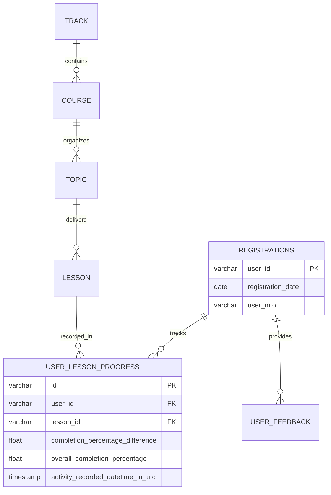

# EdTech Learning Platform User Engagement & Retention SQL Analysis

[](https://www.postgresql.org/)
[](https://www.postgresql.org/)
[](https://www.postgresql.org/)
[](https://opensource.org/licenses/MIT)

> A relational database investigation into student learning funnels, lesson completion drop-offs, track retention rates, and learner feedback sentiment across an online education platform.

---

## 🎯 Business Context & Schema Architecture

Understanding student learning curves and dropout bottlenecks is pivotal for curriculum designers and platform retention. This project constructs an analytical relational schema in PostgreSQL and queries learning interaction logs.



---

## 📋 Analytical Investigations

1. **Course Completion Funnel**: Identifies specific lessons where student completion velocity declines most sharply.
2. **Track-Level Engagement**: Compares total engagement hours across tracks to prioritize content updates.
3. **Feedback & NPS Sentiment**: Analyzes student ratings (`user_feedback`) against lesson duration to evaluate cognitive fatigue.
4. **Cohort Retention**: Groups user registration cohorts by month to evaluate 30-day and 90-day active learning retention.

---

## 📁 Repository Structure

```text
├── csv/                                                   # Raw source CSV data tables
│   ├── course_table.csv
│   ├── lesson_table.csv
│   ├── topic_table.csv
│   ├── track_table.csv
│   ├── user_feedback_table.csv
│   ├── user_lesson_progress_table.csv
│   └── user_registrations_table.csv
├── queries.sql                                            # DDL schema definitions and analytical queries
├── User Engagement and Course Performance Analysis.pdf    # Executive report deck
├── .gitignore                                             # Git ignore file
└── README.md                                              # Comprehensive documentation
```

---

## 🚀 How to Run

1. Clone this repository:
   ```bash
   git clone https://github.com/HarshKumarGuptagit/edtech-user-engagement-sql.git
   cd edtech-user-engagement-sql
   ```
2. In PostgreSQL, run the `CREATE TABLE` DDL statements from the top of `queries.sql`.
3. Import the CSV files from `/csv/` into their respective database tables.
4. Run the analytical queries to reproduce the engagement metrics.

---

## 👤 Author

**Harsh Kumar Gupta**
- GitHub: [@HarshKumarGuptagit](https://github.com/HarshKumarGuptagit)
- Email: harshkumargupta49@gmail.com
